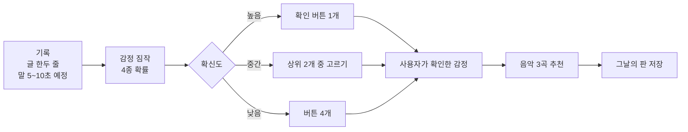

# MoodWave — 감정 기록 음악 일기

> 말 5~10초나 글 한두 줄로 하루를 기록하면, AI가 감정을 짐작하고 사용자가 확인한 감정에 맞춰 음악 3곡을 건네는 서비스입니다. 들은 곡은 "그날의 판"으로 저장됩니다.
>
> 감정 추정은 의료 진단·치료가 아닙니다.

- 팀: commit5 (부트캠프 실전 프로젝트, 참여 기업 인디제이)
- 일정: 산출물·깃허브 반영 2026-12-14, 최종 발표 2026-12-15
- 문서 기준일: 2026-11-13

---

## 1. 서비스 흐름



- **AI는 감정을 확정하지 않고 짐작만 합니다.** 추천은 예측 감정이 아니라 사용자가 버튼으로 확인한 감정(`confirmed_emotion`)으로 합니다.
- 감정 4종: **좋음 · 무난함 · 가라앉음 · 예민함**(분노·불안)
- 확신도: 가장 높은 확률이 0.6 이상이면 높음, 0.4 이상이면 중간, 그 미만이면 낮음 (모델 검증 결과에 따라 조정 예정)

## 2. 진행 현황 (2026-11-13 기준)

### 완료

| 구분 | 내용 | 담당 |
|---|---|---|
| 서버 | FastAPI 업무 API 5개 + 헬스체크, SQLite 저장, 서버 재시작 후 데이터 유지 확인 | 건호 |
| 추천 | DEAM·PMEmo 밝기(valence)·에너지(arousal) 점수 정규화, 감정별 3곡 추천 | 건호 |
| 글 감정 | 공개 모델 `hun3359/klue-bert-base-sentiment`(60가지 감정)를 4종으로 묶어 확률·확신도 산출 | 상현 |
| 연결 | `POST /api/records/analyze` — 서버가 감정 함수를 직접 호출해 기록·감정을 한 번에 저장 | 상현 |
| 안정성 | 모델·AI 패키지가 없는 컴퓨터에서도 서버와 기존 API 정상 동작(분석 경로만 503) | 상현·건호 |
| 시험 | pytest 20개 통과, Ruff 선택 규칙 통과 | 상현·건호 |
| 통합 | 글 → 감정 짐작 → 사용자 확인 → 3곡 → 판 조회 흐름 통과 (실제 모델 + 실제 DEAM 점수표) | 상현·건호 |
| 데이터 | AI 허브 감성 대화 말뭉치, 감정 분류를 위한 대화 음성 데이터셋 확보와 형식 확인 | 상현 |
| 문서 | `API_CONTRACT.md` — 화면 호출 순서, 실행 방법, 오류 처리 | 상현·건호 |

### 진행 중 · 예정

| 시기 | 내용 | 담당 |
|---|---|---|
| 11월 3주차 (11/16~) | 받아쓰기(Whisper) 연결, 글 감정 모델 미세조정(`beomi/KcELECTRA-base`), 확신도 기준 검증, 녹음 업로드 경로 | 상현 |
| 11월 3주차 (11/16~) | 최근 추천곡 제외, 좋아요·건너뛰기 기록, 추천 알고리즘 v2 설계 | 건호 |
| 11월 4주차 (11/23~) | 에이전트(곡별 추천 이유 한 줄, 금지 표현 검사), 목소리 감정 모델(wav2vec2 계열) | 상현 |
| 11월 5주차 (11/30~) | 평가 지표 측정, 전체 통합 | 전원 |
| 12월 (12/7~) | 외부 검증(다른 조 5명 이상) 반영, 수정 | 전원 |
| 진행 중 | 화면(앱·웹) 초안 제작 | 화면 담당 |

### 멘토 피드백 반영 검토 중 (11/11 피드백)

아래 항목은 팀에서 채택 범위를 정하는 중입니다.

- 감정 인식 근거 강화: 감성사전 + 모델, 목소리 파형 기반 감정 분류
- 감정별 음악 추천의 타당성 근거 정리와 측정
- 사용자 반응("안 맞아요" 등)에 따라 추천이 바뀌는 기능
- 청취 결과 분석·리포트
- 사용자 기반·아이템 기반 추천

## 3. 저장소 구조

```
commit5-music-diary/
├─ README.md
├─ API_CONTRACT.md          # API 명세서 (화면 호출 순서, 실행 방법, 오류 처리)
├─ BACKEND_SETUP.md         # 서버 시작용 안내 (초기 버전)
├─ ai/
│  ├─ requirements.txt      # 감정 모델용 패키지 (torch, transformers) — 서버 패키지와 분리
│  └─ emotion/
│     ├─ service.py         # 서버가 부르는 입구 함수 analyze_text(), warm_up()
│     ├─ emotion_mapper.py  # 60가지 감정 → 4종 변환, 확률 합 보정, 확신도
│     ├─ download_model.py  # 공개 감정 모델 내려받기
│     └─ send_to_server.py  # 개발용: 기록 생성 → 감정 저장 시험
└─ backend/
   ├─ requirements.txt      # 서버 패키지
   ├─ app/
   │  ├─ main.py            # FastAPI 경로
   │  ├─ schemas.py         # 요청·응답 검사 규칙
   │  ├─ db.py              # SQLite
   │  └─ recommender.py     # 점수 기반 3곡 추천
   └─ tests/                # pytest (모델 없이도 통과)
```

## 4. 빠른 실행

자세한 방법은 [`API_CONTRACT.md` 5번](API_CONTRACT.md)을 따릅니다. 아래는 요약입니다(Windows PowerShell).

**방법 A — 서버만 (감정 분석 없이)**

```powershell
cd backend
py -3 -m venv .venv
.\.venv\Scripts\Activate.ps1
python -m pip install -r requirements.txt
$env:MOODWAVE_SCORES_CSV="점수표 CSV 경로"   # 없으면 tests\fixtures\sample_song_scores.csv
$env:MOODWAVE_RECOMMEND_SCOPE="DEAM"
python -m uvicorn app.main:app --reload
```

**방법 B — 감정 분석까지** (파이썬 3.11 이상)

```powershell
# 방법 A의 가상환경에서, backend 폴더 기준
python -m pip install torch==2.15.0 --index-url https://download.pytorch.org/whl/cu132   # GPU가 있을 때만 (CUDA 버전에 맞게)
python -m pip install -r ..\ai\requirements.txt
python ..\ai\emotion\download_model.py
$env:MOODWAVE_MODEL_DIR="감정 모델 폴더 경로"
python -m uvicorn app.main:app --reload
```

- Swagger 문서: <http://127.0.0.1:8000/docs>
- 서버 시작 로그에 `감정 분석 꺼짐: ...`이 나오면 감정 분석만 꺼진 상태입니다(나머지 API는 정상).

**시험**

```powershell
cd backend
python -m pytest -q
python -m ruff check --select BLE,PLR0402,I .
```

## 5. API 요약

| Method | 경로 | 역할 | 주 사용처 |
|---|---|---|---|
| `POST` | `/api/records/analyze` | 기록 생성 + 감정 분석 + 저장 | 화면 기본 흐름 |
| `POST` | `/api/records` | 기록 생성 | 감정 분석 실패 시 대체 흐름 |
| `POST` | `/api/emotions` | 감정 결과 저장 | 개발·시험용 |
| `POST` | `/api/recommendations` | 확인된 감정으로 3곡 추천 | 화면 |
| `GET` | `/api/records/{record_id}/lp` | 기록과 3곡 조회 (임시 판) | 화면 |

감정 결과 양식 (`POST /api/records/analyze` 응답):

```json
{
  "record_id": 124,
  "text": "오늘 좀 지쳤어",
  "probs": {"좋음": 0.02, "무난함": 0.03, "가라앉음": 0.33, "예민함": 0.62},
  "emotion": "예민함",
  "confidence": "높음"
}
```

- `probs`는 소수 둘째 자리, 합은 정확히 1입니다.
- 분석에 실패하면 아무것도 저장하지 않고 `503`을 돌려줍니다. 빈 글은 모델 상태와 상관없이 `422`입니다.

## 6. 핵심 설계

### 6.1. 글 감정 인식

- 공개 모델의 60가지 감정을 4종으로 묶습니다. 당황·놀람처럼 애매한 감정 8개는 제외하고, 나머지 확률을 다시 나눠 4종 합을 1로 맞춥니다.
- 모델은 서버가 켜질 때 한 번만 불러옵니다(약 2초). 이후 글 한 줄 분석은 약 5ms입니다(RTX 5060 Ti 기준).
- 서버는 `ai/emotion/service.py`의 `analyze_text()`만 부릅니다. 안쪽 모델을 바꿔도 서버 코드와 결과 양식은 바뀌지 않습니다.
- 현재 공개 모델은 짧은 구어체에서 틀리는 경우가 있습니다(시험 6문장 중 4개 정답). 3주차에 감성 대화 말뭉치로 미세조정해 교체합니다.

### 6.2. 음악 추천

- 곡마다 밝기(valence)·에너지(arousal) 점수가 있고, 감정별 목표 좌표에 가장 가까운 곡을 고릅니다.
- 3곡은 순서에 의미가 있습니다.

| 확인된 감정 | 1곡 | 2곡 | 3곡 |
|---|---|---|---|
| 좋음·무난함 | 비슷한 분위기 1 | 비슷한 분위기 2 | 비슷한 분위기 3 |
| 가라앉음 | 맞추기 | 조금 밝게 | 더 밝게 |
| 예민함 | 맞추기 | 에너지 낮추기 | 차분하고 조금 밝게 |

- 가라앉음·예민함의 "지금 기분에 맞춘 뒤 서서히 옮겨 가기"는 음악치료의 동질의 원리(iso principle)와 같은 구조입니다. 이 원리에 대한 실험 근거는 부분적이어서([출처](https://pmc.ncbi.nlm.nih.gov/articles/PMC8656869)), 서비스 안에서 감상 전후 기분을 직접 재서 확인할 계획입니다.
- 목표 좌표는 1차 구현값이며, 사용자 평가 후 조정합니다.

## 7. 데이터와 저작권

**이 저장소에는 원본 데이터, 음원, 모델 파일이 들어 있지 않습니다.** 각자 컴퓨터의 저장소 밖 폴더(예: `C:\work\moodwave_data`)에 두고, `.gitignore`로 막아 둡니다.

| 데이터 | 용도 | 비고 |
|---|---|---|
| DEAM | 곡 밝기·에너지 점수, 시연 곡 | 45초 발췌 1,744곡 + 전곡 58곡 = 1,802곡. 저자 공개 조건은 비상업 크리에이티브 커먼즈(BY-NC). 공개 시연 재생 조건은 팀 확인 중 |
| PMEmo | 곡 점수 (내부 시험 범위) | 공개 시연에는 DEAM만 사용 |
| AI 허브 감성 대화 말뭉치 | 글 감정 미세조정·평가 | 재배포 금지. 저장소에 올리지 않음 |
| AI 허브 감정 분류를 위한 대화 음성 데이터셋 | 목소리 감정 모델 | 재배포 금지. 저장소에 올리지 않음 |
| KOTE | 무난함(감정 없음) 문장 보충 | 3주차 사용 예정 |

- 녹음 원본은 감정 인식 직후 삭제하고, 받아쓴 글만 저장하는 것이 원칙입니다(녹음 기능 구현 시 적용).

## 8. 평가 지표 (목표)

| 지표 | 목표 | 현재 |
|---|---|---|
| 감정 인식 F1 (화자 분리 평가 자료) | 0.60 | 공개 모델 기준 점수 측정 예정 |
| 녹음 끝 → 감정 확인 화면 | 5초 이내 | 글 감정 약 5ms. 받아쓰기 시간 측정 예정 |
| 에이전트 출력 형식 준수율 | 95% | 4주차 |
| 도구 결과 밖 내용(환각) | 0건 | 4주차 |
| 위험 표현 문장에 상담전화 109 안내 | 100% | 4주차 |

## 9. 협업 규칙

- 각자 `feature/...` 가지에서 작업하고 PR로 합칩니다. 검토 후 머지합니다.
  - 상현: `feature/emotion-model`
  - 건호: `feature/backend-api`
- 다른 사람 작업이 `main`에 합쳐지면:
  ```powershell
  git checkout main
  git pull origin main
  git checkout feature/<내 가지>
  git merge main
  ```
- 커밋 전 `git status`로 `__pycache__`, `.db`, `.ruff_cache`, 데이터, 모델 파일이 없는지 확인합니다. `git add .` 대신 파일 이름을 직접 적습니다.
- 기존 시험(`backend/tests`)과 Ruff 검사를 통과해야 머지합니다.
- API나 결과 양식을 바꿀 때는 코드보다 먼저 `API_CONTRACT.md`를 고치고 팀에 공유합니다.

## 10. 팀

| 이름 | 역할 |
|---|---|
| 상현 ([@archi9718-do](https://github.com/archi9718-do)) | 받아쓰기, 글·목소리 감정 모델, 확신도, 에이전트, 평가 지표 측정 |
| 건호 ([@choegho](https://github.com/choegho)) | FastAPI 서버·DB, 음악 추천 알고리즘, 판·리캡 저장, 녹음 동의 기록 |
| 화면 담당 | 앱·웹 화면 |
